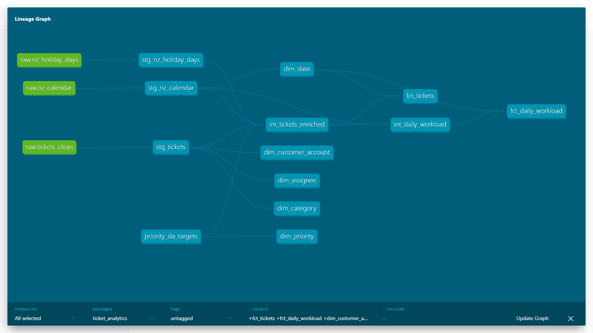

# dbt ticket analytics

A dbt project that rebuilds the star schema from my Ticket Analytics Power BI
report as a tested warehouse in DuckDB: 100,851 service-desk tickets taken
through staging, intermediate and mart layers, with tests that fail the build
if the grain, the joins or the data quality rules break.

The dataset is synthetic, the cleaned output of
[Ticket-analytics-pipeline](https://github.com/rafif-212/Ticket-analytics-pipeline).
Names, emails and companies in it are generated. There is no BI layer here;
the Power BI report lives in that project.

## Findings worth knowing before reading the numbers

These come from profiling the source for this build. Each one is flagged in
the models or reported by a test, not patched. [docs/DATA_GAPS.md](docs/DATA_GAPS.md)
has the full detail and the query behind every figure.

- **Intake stops at the end of 2024.** Tickets run 1 Jul 2023 to 31 Dec 2024,
  plus 10 tickets on 15 Mar 2025. The date dimension keeps the 89 empty days
  in 2025 as zeros so the gap stays visible.
- **Dates have no time of day.** Every timestamp is midnight, so durations are
  a range of hours, not a figure, and a 4 or 8 hour SLA target often can't be
  judged either way.
- **`resolution_time_hours` doesn't reconcile with the dates.** It fits the
  created and resolved dates for 13.4% of valid resolved tickets, with a
  correlation of -0.001. It's kept for comparison only.
- **The supplied `sla_breached` flag doesn't track resolution time.** It's set
  on ~50% of tickets whether the dates show them as met or breached. SLA
  outcome is derived from the dates instead.
- **No reopen history and no first-response timestamp.** Reopen count is left
  out; first response is carried as supplied, with 2,724 impossible values
  reported by a warning.
- **702 tickets fail a quality rule**, 669 of them only because the ticket
  predates its customer account. Flagged rather than deleted.

## How to run it

Set up a virtual environment once:

```bash
git clone https://github.com/rafif-212/dbt-ticket-analytics.git
cd dbt-ticket-analytics
python -m venv .venv
.venv\Scripts\activate             # on macOS or Linux: source .venv/bin/activate
pip install -r requirements.txt    # dbt-core, dbt-duckdb and duckdb, pinned
```

Then two commands build everything:

```bash
python load_data.py    # download the source Parquet files and load them into DuckDB
dbt build              # build and test every model
```

`load_data.py` downloads the four files from a fixed commit of
Ticket-analytics-pipeline, so the build doesn't change if that project does.
`--source-dir PATH` loads a local copy instead. The `profiles.yml` in the repo
points dbt at `ticket_analytics.duckdb` in the project folder, so there is
nothing to configure.

The build should finish with `PASS=106 WARN=3 ERROR=0`: 13 models, 1 seed and
95 tests. The three warnings are known source defects that are reported on
every build rather than failing it (see the tests table below).

To browse the models and the lineage graph:

```bash
dbt docs generate
dbt docs serve
```

Tested on Windows 11 with Python 3.14.2, dbt-core 1.12.5 and dbt-duckdb
1.11.0. Not tested on macOS or Linux.

## What's in here

| Path | What it is |
|---|---|
| `load_data.py` | Downloads the source Parquet files and loads them unchanged into a `raw` schema |
| `models/staging/` | One view per source table: renamed, cast and trimmed, nothing else |
| `models/intermediate/` | Ticket-level logic (durations, SLA outcome, quality rules, holiday match) and the daily workload rebuild |
| `models/marts/` | The star schema: five dimensions, a ticket fact and a daily workload fact |
| `seeds/priority_sla_targets.csv` | The standard SLA target for each priority, the one business rule kept as data |
| `tests/` | Singular tests for grain, joins, date coverage and known defects |
| `analyses/` | The queries behind every number in DATA_GAPS.md |
| `macros/` | Text cleaning, integer date keys and layer-named schemas |
| `docs/DATA_GAPS.md` | What the data can't tell you |
| `docs/DECISIONS.md` | Why each modelling choice was made and what was rejected |
| `docs/ISSUES.md` | Problems found during the build, including mistakes in my own plan |

## Why three layers

**Staging** exists so every later model reads clean, consistently named
columns and never touches the source directly. It only renames, casts and
trims. Supplied figures that don't reconcile keep a `supplied_` prefix so
nobody mistakes them for derived ones. Views, because they cost nothing to
build.

**Intermediate** is where joins and business logic live: durations from the
dates, the SLA outcome, the four quality rules, the regional holiday match
and the daily workload rebuild. Keeping it separate means the marts only
shape data and never decide anything. Views rather than ephemeral models, so
the tests can run against them.

**Marts** are the star schema reports query, materialised as tables:

| Table | Grain | Rows |
|---|---|---|
| `fct_tickets` | One row per ticket | 100,851 |
| `fct_daily_workload` | One row per day | 640 |
| `dim_date` | One row per day, plus -1 (invalid date) and -2 (not resolved) | 642 |
| `dim_customer_account` | One row per customer account | 5,976 |
| `dim_assignee` | One row per assignee, plus Unassigned | 20 |
| `dim_category` | One row per cleaned category | 10 |
| `dim_priority` | One row per priority | 4 |

It mirrors the Power BI model's tickets, calendar and daily workload tables.
It differs in two places: regional holidays are a flag on the fact rather than
a relationship, and there is a customer account dimension the Power BI model
didn't have. [docs/DECISIONS.md](docs/DECISIONS.md) explains both.

## Lineage



`stg_daily_workload` isn't shown because nothing is built from it; it only
feeds the test that checks the rebuilt daily workload against the original.

## What the tests protect against

Generic tests cover `unique` and `not_null` on every primary key,
`relationships` from every fact key to its dimension, and `accepted_values`
on status, priority, category, channel, team and SLA target. The singular
tests cover what those can't:

| Test | Fails when |
|---|---|
| `assert_fact_grain_matches_staging` | The ticket fact has more or fewer rows than distinct tickets in staging, the fan-out that silently doubles every count |
| `assert_fact_joins_every_dimension_once` | Joining the fact to all five dimensions drops or duplicates a row, for example from a duplicated dimension key |
| `assert_resolved_not_before_created_unless_flagged` | A ticket resolved before it was created reaches the mart without the quality flag |
| `assert_quality_rules_match_supplied_flag` | The quality rules re-derived here disagree with the original project's flag on any ticket |
| `assert_daily_workload_matches_source` | The rebuilt daily intake or backlog differs from the original table on any day |
| `assert_date_dimension_is_continuous` | A day is missing from the date dimension, which would hide days with no tickets |
| `assert_invalid_date_key_only_on_flagged_tickets` | An unflagged ticket lands on the invalid-date member and drops out of date-based reports |
| `assert_resolved_date_matches_status` | A resolved ticket has no resolved date, or an open one has one |
| `assert_assignee_and_team_missing_together` | A ticket has a team but no assignee, and would lose its team in the mart |
| `assert_source_timestamps_have_no_time_of_day` | The source gains a time of day, so casting to dates would start throwing information away |

Three tests run at warn severity. They report source defects that are already
flagged, so the counts stay visible without blocking the build:
`warn_resolved_before_created` (25), `warn_nonstandard_sla_target` (779) and
`warn_first_response_after_resolution` (2,724).

To check the tests fail when they should, I broke the models on purpose and
reverted each change. Doubling every fact row failed
`assert_fact_grain_matches_staging` and the unique test on `ticket_id`.
Duplicating a category failed the unique test on `dim_category`. Removing the
"created before account" rule failed `assert_quality_rules_match_supplied_flag`
on 669 tickets.

## Related

- [Ticket-analytics-pipeline](https://github.com/rafif-212/Ticket-analytics-pipeline):
  the cleaning, the Power BI report and the SQL agent this project builds on.
